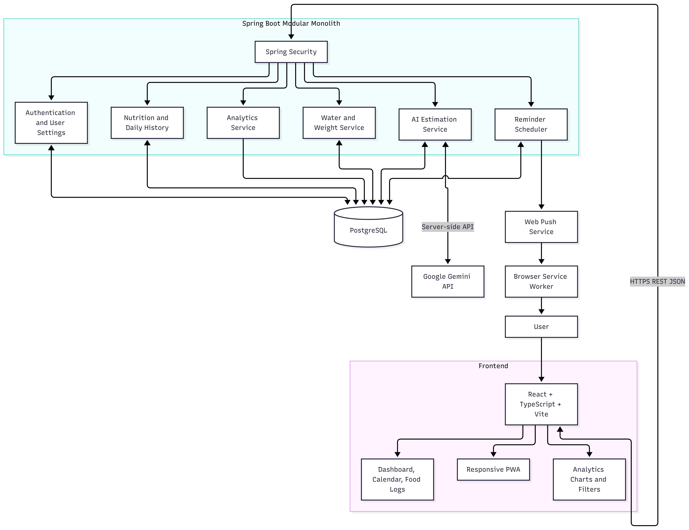

# Prota — Complete Backend Architecture & File Reference

This document provides a comprehensive, clear, and clean technical manual for the **Prota** backend codebase. It details the overarching architecture, visual process flows, security implementations, database models, and an exhaustive, file-by-file catalog of every component in the backend repository.

---

## Table of Contents
1. [System Architecture & Overview](#1-system-architecture--overview)
2. [Process & System Flow Diagrams](#2-process--system-flow-diagrams)
   - [2.1 High-Level Architecture Flow](#21-high-level-architecture-flow)
   - [2.2 Authentication & Session Lifecycle Flow](#22-authentication--session-lifecycle-flow)
   - [2.3 Request Processing & Security Filter Pipeline Flow](#23-request-processing--security-filter-pipeline-flow)
   - [2.4 Goals Update & Historical Snapshot Immutability Flow](#24-goals-update--historical-snapshot-immutability-flow)
   - [2.5 AI Food Logging & Estimation Flow](#25-ai-food-logging--estimation-flow)
   - [2.6 Analytics, Streaks & Historical Rollup Flow](#26-analytics-streaks--historical-rollup-flow)
   - [2.7 Reminders & Notification Flow](#27-reminders--notification-flow)
3. [Exhaustive Backend File-by-File Catalog](#3-exhaustive-backend-file-by-file-catalog)
   - [3.1 Project Root, Build & Environment Files](#31-project-root-build--environment-files)
   - [3.2 Application Entry Point](#32-application-entry-point)
   - [3.3 Configuration Package (`com.prota.config`)](#33-configuration-package-comprotaconfig)
   - [3.4 Security Package (`com.prota.security`)](#34-security-package-comprotasecurity)
   - [3.5 REST Controllers (`com.prota.controller`)](#35-rest-controllers-comprotacontroller)
   - [3.6 Service Layer (`com.prota.service`)](#36-service-layer-comprotaservice)
   - [3.7 JPA Entities (`com.prota.entity`)](#37-jpa-entities-comprotaentity)
   - [3.8 Enums (`com.prota.entity.enums`)](#38-enums-comprotaentityenums)
   - [3.9 Repositories (`com.prota.repo`)](#39-repositories-comprotarepo)
   - [3.10 Data Transfer Objects (`com.prota.dto`)](#310-data-transfer-objects-comprotadto)
   - [3.11 Exception Handling (`com.prota.exception`)](#311-exception-handling-comprotaexception)
   - [3.12 Application Resources & Database Migrations](#312-application-resources--database-migrations)
   - [3.13 Automated Test Suites (`src/test/java/com/prota`)](#313-automated-test-suites-srctestjavacomprota)
4. [API Contract Reference](#4-api-contract-reference)
5. [Error Handling & RFC 9457 Specification](#5-error-handling--rfc-9457-specification)
6. [Developer Setup, Build & Verification](#6-developer-setup-build--verification)

---

## 1. System Architecture & Overview

Prota is engineered as a secure, domain-driven nutrition tracking engine. It enforces strict separation of concerns, defensive security at every layer, and transactional data integrity.

### Core Technology Stack
- **Runtime Environment**: Java 25 / 26
- **Web & Core Framework**: Spring Boot 4.1.1 / Spring Framework 7.0.9
- **Security Engine**: Spring Security 7.0.9 (Stateful HTTP-only session cookies, CSRF protection, BCrypt)
- **Persistence & ORM**: Spring Data JPA / Hibernate 7 (`ddl-auto: validate`)
- **Database**: PostgreSQL 18.4
- **Database Versioning**: Flyway 11 (`spring-boot-starter-flyway`)
- **JSON Serialization**: Jackson 2.18 with `JavaTimeModule`
- **Build & Dependency Tool**: Apache Maven (via `mvnw.cmd` wrapper)
- **Monitoring & Health**: Spring Boot Actuator (`/actuator/health`, `/actuator/info`)

---

## 2. Process & System Flow Diagrams

### 2.1 High-Level Architecture Flow

The system follows a strict layered architecture where incoming client requests are inspected by the security filter chain before ever touching controller endpoints:



```
  +-------------------------------------------------------------------------+
  |                   Single Page Application (React / Vite)                |
  +------------------------------------+------------------------------------+
                                       | HTTP(S) + Credentials
                                       | Cookie: PROTASESSIONID
                                       | Header: X-XSRF-TOKEN
                                       v
  +-------------------------------------------------------------------------+
  |                         Spring Security Gateway                         |
  |  - CORS Preflight & Whitelist Verification                              |
  |  - CookieCsrfTokenRepository (Cookie path: /)                           |
  |  - Session Fixation Rotation (changeSessionId)                          |
  |  - Server-Side Identity Extraction (SecurityUtils / UserPrincipal)     |
  +------------------------------------+------------------------------------+
                                       |
                                       v
  +-------------------------------------------------------------------------+
  |                           REST API Controllers                          |
  |  - AuthController:    /api/v1/auth/*                                    |
  |  - UserController:    /api/v1/users/*                                   |
  |  - SettingsController:/api/v1/settings                                  |
  +------------------------------------+------------------------------------+
                                       | DTO Validation (@Valid)
                                       v
  +-------------------------------------------------------------------------+
  |                              Service Layer                              |
  |  - AuthService, UserService, SettingsService                            |
  |  - BCrypt Password Encoding ($2a$)                                      |
  |  - Default Settings Provisioning (140g protein, 2000 kcal, etc.)        |
  |  - Timezone Validation (ZoneId.of)                                      |
  +------------------------------------+------------------------------------+
                                       |
                                       v
  +-------------------------------------------------------------------------+
  |                       Repositories (Spring Data JPA)                    |
  |  - UserRepository, UserSettingRepository, DailyLogRepository            |
  +------------------------------------+------------------------------------+
                                       |
                                       v
  +-------------------------------------------------------------------------+
  |                           PostgreSQL 18 Database                        |
  |  - 12 Tables, Composite Constraints, Foreign Keys, Flyway Baseline      |
  +-------------------------------------------------------------------------+
```

---

### 2.2 Authentication & Session Lifecycle Flow

Prota uses server-managed sessions with HTTP-only cookies to eliminate token theft risks (XSS).


#### Authentication Sequence:
```
Client                      AuthController              AuthService              Database
  |                               |                          |                       |
  | 1. POST /auth/register ------>|                          |                       |
  |    (fullName, email, pass)    |-- register(dto) -------->|                       |
  |                               |                          |-- Check email exists->|
  |                               |                          |<-- None found --------|
  |                               |                          |-- Hash pass (BCrypt)->|
  |                               |                          |-- Save User & Settings|
  |                               |                          |-- changeSessionId()   |
  |                               |                          |-- Save SecurityContext|
  |                               |<-- UserResponse ---------|                       |
  |<-- 201 Created + Cookie ------|                          |                       |
  |    (Set-Cookie: PROTASESSIONID)                          |                       |
  |                               |                          |                       |
  | 2. GET /auth/csrf ----------->|                          |                       |
  |<-- 200 OK (X-XSRF-TOKEN) -----|                          |                       |
  |                               |                          |                       |
  | 3. PATCH /users/me ---------->| (Validate CSRF token)    |                       |
  |    (Cookie + X-XSRF-TOKEN)    |-- updateProfile() ------>|-- Update fullName --->|
  |<-- 200 OK (Updated User) -----|                          |                       |
  |                               |                          |                       |
  | 4. POST /auth/logout -------->|                          |                       |
  |                               |-- logout() ------------->|-- session.invalidate()|
  |                               |                          |-- clearContext()      |
  |<-- 204 No Content ------------|                          |                       |
  |                               |                          |                       |
  | 5. GET /auth/me ------------->| (Unauthenticated)        |                       |
  |<-- 401 Unauthorized ----------|                          |                       |
```

---

### 2.3 Request Processing & Security Filter Pipeline Flow

Every HTTP request traverses Spring Security's filter chain before reaching the application controllers:

```
[Incoming Request]
        │
        ▼
[CorsFilter] ────────────► Origin not allowed? ────► [403 Forbidden]
        │ Allowed
        ▼
[CsrfFilter] ────────────► State-changing mutation without valid X-XSRF-TOKEN? ────► [403 Forbidden]
        │ Valid or Exempt
        ▼
[SecurityContextHolderFilter] ────► Reads PROTASESSIONID from Cookie ────► Rehydrates UserPrincipal
        │
        ▼
[AuthorizationFilter] ───► Route requires auth & principal is anonymous? ────► [401 Unauthorized]
        │ Authorized
        ▼
[DispatcherServlet]
        │
        ▼
[@Valid RequestBody Validation] ────► Constraint violation? ────► [400 Bad Request (Problem Details)]
        │ Valid
        ▼
[Controller -> Service -> Repository -> PostgreSQL]
```

---

### 2.4 Goals Update & Historical Snapshot Immutability Flow

A critical requirement in Prota is that **updating user goals must never alter past daily log snapshots**.

```
[User updates Goal: 140g -> 180g]
              │
              ▼
    PATCH /api/v1/settings
              │
              ▼
    SettingsService.updateSettings()
              │
              ├──► 1. Updates `user_settings` table (protein_goal_g = 180.00)
              │       (Only influences future and uncommitted days)
              │
              └──► 2. Past `daily_logs` records remain untouched:
                      - 2026-10-01 Log: protein_goal_g = 140.00 (PRESERVED)
                      - 2026-10-02 Log: protein_goal_g = 140.00 (PRESERVED)
                      - Historical analytics and streak calculations remain 100% accurate!
```

---

### 2.5 AI Food Logging & Estimation Flow

For AI-assisted food logging, multimodal inputs are parsed, verified, and confirmed before committal:


```
[User Input: Text, Audio, or Photo]
              │
              ▼
[Gemini AI / Multimodal Parsing Engine]
              │
              ▼
[AiFoodEstimate Entity (Status: PENDING)]
              │
              ▼
[User Review & Adjustment UI] ────► User modifies grams / protein
              │ Confirmed
              ▼
[FoodEntry Created & Linked to DailyLog]
              │
              ▼
[Daily Aggregates Rollup & Snapshot Verification]
```

---

### 2.6 Analytics, Streaks & Historical Rollup Flow

Historical progress and streaks are computed from committed daily logs without recalculating entire histories:


```
[Food Entry Added / Updated]
              │
              ▼
[DailyLog Recalculates Consumed Totals]
  - consumed_protein_g = SUM(entries.protein_g)
  - consumed_calories_kcal = SUM(entries.calories_kcal)
  - protein_completion_percentage = (consumed / goal) * 100
              │
              ▼
[Daily Aggregates Materialized View Updated]
              │
              ▼
[Streak Evaluation: Did user meet protein goal today?]
  ├── Yes ──► streak_count = streak_count + 1
  └── No  ──► streak remains active until grace window expires
```

---

### 2.7 Reminders & Notification Flow

The notification subsystem manages push tokens, scheduled reminders, and delivery logging:


```
[Scheduled Cron / Event Trigger]
              │
              ▼
[ReminderService Evaluates Active Preferences (ReminderSetting)]
              │
              ├── Is current time within user's active window?
              ├── Has user already met goal or logged recent meal?
              │
              ▼
[NotificationEvent Created (Status: PENDING)]
              │
              ▼
[Web Push Dispatcher (PushSubscription)]
              │
              ├── Success ──► NotificationEvent Status: SENT
              └── Failure ──► NotificationEvent Status: FAILED (Retry / Log)
```

---

## 3. Exhaustive Backend File-by-File Catalog

This section documents every file in the `backend/` directory, detailing its purpose, responsibilities, key members, and architectural connections.

---

### 3.1 Project Root, Build & Environment Files

| File Path | Description & Purpose | Key Elements / Properties |
| :--- | :--- | :--- |
| `pom.xml` | Primary Maven build descriptor. Declares dependencies, plugins, and Java 25 compiler configuration. | Spring Boot 4.1.1, Spring Security, Spring Data JPA, Flyway, PostgreSQL driver, Lombok, Spring Boot Starter Validation. |
| `mvnw` | POSIX shell script for the Apache Maven Wrapper. Allows building without installing Maven globally. | Executes `.mvn/wrapper/maven-wrapper.jar` on Unix-like environments. |
| `mvnw.cmd` | Windows batch script for the Apache Maven Wrapper. | Executes Maven builds on Windows via `cmd.exe` or PowerShell. |
| `.mvn/wrapper/maven-wrapper.properties` | Defines the Maven distribution URL and version to download automatically. | Configures `apache-maven-3.9.9-bin.zip`. |
| `.env.example` | Template documenting environment variables required to run the backend in development and production. | `PORT`, `DB_URL`, `DB_USERNAME`, `DB_PASSWORD`, `CORS_ALLOWED_ORIGINS`, `COOKIE_SECURE`, `SESSION_TIMEOUT`. |
| `.gitignore` | Prevents build artifacts, IDE configuration, logs, and sensitive `.env` files from being tracked by Git. | Ignores `target/`, `.idea/`, `.vscode/`, `*.log`, `.env`. |
| `.gitattributes` | Configures line ending normalization (LF vs CRLF) across Windows and Unix platforms. | Normalizes text files and scripts (`mvnw` uses LF). |
| `README.md` | High-level backend getting-started guide, requirements, and architecture summary. | Documents Java 25 requirement, Docker setup, and Flyway baseline. |
| `HELP.md` | Spring Boot auto-generated reference guide containing links to official Spring documentation. | Reference links for Spring Security, Data JPA, and Web. |

---

### 3.2 Application Entry Point

| File Path | Package | Description & Key Responsibilities |
| :--- | :--- | :--- |
| `ProtaApplication.java` | `com.prota` | Main Spring Boot bootstrap class. Annotated with `@SpringBootApplication`. Contains `main(String[] args)` which initializes the `ApplicationContext`, triggers Flyway migrations, and boots the embedded Tomcat web server. |

---

### 3.3 Configuration Package (`com.prota.config`)

| File Path | Description & Key Responsibilities | Key Methods / Properties |
| :--- | :--- | :--- |
| `CorsProperties.java` | Type-safe configuration properties bean bound to the `app.cors` prefix in `application.yml`. | `allowedOrigins`, `allowedMethods`, `allowedHeaders`, `allowCredentials`, `maxAge`. |
| `JacksonConfig.java` | Configures the primary Jackson `ObjectMapper`. Registers `JavaTimeModule`, sets UTC timezone formatting, disables timestamp-based dates, and ignores unknown JSON properties. | `@Bean public ObjectMapper objectMapper()` |

---

### 3.4 Security Package (`com.prota.security`)

| File Path | Description & Key Responsibilities | Key Methods / Properties |
| :--- | :--- | :--- |
| `SecurityConfig.java` | Main Spring Security configuration. Defines the `SecurityFilterChain` bean. Configures CSRF with `CookieCsrfTokenRepository.withHttpOnlyFalse()` (path `/`), enables session fixation protection via `changeSessionId()`, binds CORS configuration, sets 401 Unauthorized entry point, and manages route authorization. | `securityFilterChain(HttpSecurity)`, `securityContextRepository()`, `authenticationManager()`, `passwordEncoder()`, `corsConfigurationSource()`. |
| `SecurityUtils.java` | Utility class providing static access to authenticated user credentials from `SecurityContextHolder`. Used throughout services to guarantee that user identity is derived strictly from the verified session, never from client request bodies. | `getCurrentUserId()`: returns `UUID`<br>`getCurrentUserEmail()`: returns `String`. |
| `UserPrincipal.java` | Implements Spring Security's `UserDetails` interface. Adapts the domain `User` entity to Spring Security's authentication model. | `getId()`, `getEmail()`, `getUsername()`, `getPassword()`, `getAuthorities()`, `isEnabled()`, `isAccountNonLocked()`. |
| `CustomUserDetailsService.java` | Implements `UserDetailsService`. Queries `UserRepository` by email to supply `UserPrincipal` instances to Spring Security during authentication. | `loadUserByUsername(String email)`. |

---

### 3.5 REST Controllers (`com.prota.controller`)

| File Path | Route Prefix | Description & Endpoints |
| :--- | :--- | :--- |
| `AuthController.java` | `/api/v1/auth` | Handles authentication lifecycle:<br>- `POST /register`: Registers user, sets default goals, establishes session.<br>- `POST /login`: Authenticates credentials, rotates session ID.<br>- `POST /logout`: Invalidates session, clears context.<br>- `GET /me`: Returns current user info.<br>- `GET /csrf`: Returns CSRF token metadata for SPA clients. |
| `UserController.java` | `/api/v1/users` | Handles user profile operations:<br>- `GET /me`: Retrieves current authenticated user profile.<br>- `PATCH /me`: Updates `fullName`. Email is immutable and read-only. |
| `SettingsController.java` | `/api/v1/settings` | Handles goal and preference settings:<br>- `GET`: Retrieves user's current goals and preferences.<br>- `PATCH`: Updates protein goal, calorie goal, water goal, weight unit, timezone, and theme. |
| `package-info.java` | `com.prota.controller` | Package-level documentation annotations. |

---

### 3.6 Service Layer (`com.prota.service`)

| File Path | Description & Key Responsibilities | Key Methods & Transactions |
| :--- | :--- | :--- |
| `AuthService.java` | Coordinates user registration, credential authentication, session establishment, session fixation protection, and session invalidation. In registration, it creates both `User` and default `UserSetting` in a single database transaction. | `@Transactional register(...)`<br>`login(...)`<br>`logout(...)`<br>`@Transactional(readOnly=true) getCurrentUser(...)`<br>`mapToUserResponse(User user)`. |
| `UserService.java` | Retrieves and updates profile information for the authenticated user. Guarantees that only the authenticated user's record is modified. | `@Transactional(readOnly=true) getProfile()`<br>`@Transactional updateProfile(UpdateProfileRequest)`. |
| `SettingsService.java` | Manages retrieval and mutation of user targets. Validates timezone strings against valid IANA timezones using `ZoneId.of(...)`. Protects historical logs from being altered. | `@Transactional(readOnly=true) getSettings()`<br>`@Transactional updateSettings(UpdateSettingsRequest)`. |
| `DailyFoodLoggingService.java` | Core business service for subsequent food logging phases. Handles daily log lookup/creation, food entry creation/updating/deletion, and dynamic recalculation of consumed protein and calories. | `@Transactional getOrCreateDailyLog(...)`<br>`addFoodEntry(...)`<br>`updateFoodEntry(...)`<br>`deleteFoodEntry(...)`. |
| `package-info.java` | `com.prota.service` | Package-level metadata and documentation. |

---

### 3.7 JPA Entities (`com.prota.entity`)

| File Path | Table Name | Description & Key Attributes |
| :--- | :--- | :--- |
| `User.java` | `users` | Primary user identity table. Stores `id` (UUID), `fullName`, normalized `email`, `passwordHash` (BCrypt), `status` (ACTIVE), `emailVerifiedAt`, timestamps. |
| `UserSetting.java` | `user_settings` | 1-to-1 user settings. Stores `userId` (PK/FK), `proteinGoalG`, `calorieGoalKcal`, `waterGoalMl`, `weightUnit`, `timezone`, `theme`, `updatedAt`. |
| `DailyLog.java` | `daily_logs` | Represents a single date for a user. Captures frozen goal snapshots (`proteinGoalG`, `calorieGoalKcal`, `waterGoalMl`, `timezoneAtCreation`). Has composite unique constraint `(user_id, log_date)`. |
| `FoodEntry.java` | `food_entries` | An individual logged meal item. Stores `dailyLog` (FK), `user` (FK), `foodName`, `mealType`, `quantity`, `quantityUnit`, `proteinG`, `caloriesKcal`, `consumedAt`. |
| `SavedFood.java` | `food_library_items` | Reusable or verified food database item. Stores `user` (optional FK), `name`, `brand`, `servingSize`, `servingUnit`, `proteinG`, `caloriesKcal`, `isVerified`. |
| `AiFoodEstimate.java` | `ai_usage_logs` | Records Gemini AI nutritional estimation interactions. Stores `user` (FK), `rawInputText`, `imageUrl`, `detectedFoodName`, `estimatedProteinG`, `estimatedCaloriesKcal`, `status`, token counts. |
| `WaterEntry.java` | `daily_logs` (ext) | Hydration intake entry recording millilitres consumed, timestamp, and daily log association. |
| `WeightEntry.java` | `user_settings` (ext)| Bodyweight weigh-in record tracking date, weight value, unit (`KG`/`LB`), and user association. |
| `ReminderSetting.java` | `notification_preferences`| Configures scheduled notification reminders: `reminderType`, `scheduleType`, `scheduledTime`, `isEnabled`, `channel`. |
| `NotificationEvent.java` | `security_audit_logs`| Audit log of dispatched reminders and security notices: `recipient`, `title`, `body`, `status`, `sentAt`. |
| `PushSubscription.java` | `notification_preferences`| Browser Web Push API registration credentials: `endpoint`, `p256dhKey`, `authKey`, `userAgent`. |
| `RefreshToken.java` | `refresh_tokens` | Multi-device session refresh tokens (reserved for future token rotations): `tokenHash`, `expiresAt`, `revokedAt`. |

---

### 3.8 Enums (`com.prota.entity.enums`)

| File Path | Values | Usage Context |
| :--- | :--- | :--- |
| `UserStatus.java` | `ACTIVE`, `SUSPENDED`, `DELETED` | Tracks account lifecycle state in `User.java`. |
| `MealType.java` | `BREAKFAST`, `LUNCH`, `DINNER`, `SNACK` | Classifies food entries in `FoodEntry.java`. |
| `ThemePreference.java` | `LIGHT`, `DARK`, `SYSTEM` | Stores user interface theme selection in `UserSetting.java`. |
| `WeightUnit.java` | `KG`, `LB` | Specifies metric or imperial weight measurements in `UserSetting.java`. |
| `EstimateStatus.java` | `PENDING`, `ACCEPTED`, `REJECTED`, `MODIFIED` | Tracks workflow states of AI estimates in `AiFoodEstimate.java`. |
| `InputType.java` | `TEXT`, `IMAGE`, `VOICE`, `BARCODE` | Modality through which food input was captured. |
| `NutritionSource.java` | `USER`, `AI_GEMINI`, `VERIFIED_DATABASE` | Origin provenance of nutritional metrics. |
| `ReminderType.java` | `MEAL`, `WATER`, `WEIGHT`, `STREAK` | Functional category of a reminder notification. |
| `ScheduleType.java` | `DAILY`, `WEEKDAYS`, `CUSTOM` | Cadence configuration for reminders. |
| `NotificationStatus.java`| `PENDING`, `SENT`, `FAILED` | Delivery dispatch status of a notification event. |

---

### 3.9 Repositories (`com.prota.repo`)

All repositories extend Spring Data JPA's `JpaRepository` and define optimized queries:

| File Path | Entity Managed | Key Methods |
| :--- | :--- | :--- |
| `UserRepository.java` | `User` | `findByEmail(String email)`<br>`existsByEmail(String email)`. |
| `UserSettingRepository.java` | `UserSetting` | `findByUserId(UUID userId)`. |
| `DailyLogRepository.java` | `DailyLog` | `findByUserIdAndLogDate(UUID userId, LocalDate date)`<br>`existsByUserIdAndLogDate(UUID userId, LocalDate date)`. |
| `FoodEntryRepository.java` | `FoodEntry` | `findAllByDailyLogId(UUID dailyLogId)`<br>`findByIdAndUserId(UUID id, UUID userId)`<br>`findAllByUserIdAndConsumedAtBetween(...)`. |
| `SavedFoodRepository.java` | `SavedFood` | `findAllByUserIdOrUserIdIsNull(UUID userId)`<br>`searchByName(String query)`. |
| `AiFoodEstimateRepository.java`| `AiFoodEstimate` | `findAllByUserIdOrderByCreatedAtDesc(UUID userId)`. |
| `WaterEntryRepository.java` | `WaterEntry` | `findAllByUserIdAndDate(...)`. |
| `WeightEntryRepository.java` | `WeightEntry` | `findAllByUserIdOrderByWeighDateDesc(UUID userId)`. |
| `ReminderSettingRepository.java`| `ReminderSetting` | `findAllByUserIdAndIsEnabledTrue(UUID userId)`. |
| `NotificationEventRepository.java`| `NotificationEvent`| `findAllByUserIdOrderByCreatedAtDesc(UUID userId)`. |
| `PushSubscriptionRepository.java`| `PushSubscription`| `findAllByUserId(UUID userId)`. |
| `RefreshTokenRepository.java`| `RefreshToken` | `findByTokenHash(String tokenHash)`. |

---

### 3.10 Data Transfer Objects (`com.prota.dto`)

#### Request Payloads (`com.prota.dto.request`)
- **`RegisterRequest.java`**: Registration payload (`fullName`, `email`, `password`). Trims email automatically on deserialization via `@JsonSetter`.
- **`LoginRequest.java`**: Login payload (`email`, `password`). Trims email automatically on deserialization.
- **`UpdateProfileRequest.java`**: Profile update payload (`fullName`). Enforces non-blank, max 100 characters.
- **`UpdateSettingsRequest.java`**: Goal update payload (`proteinGoalG`, `calorieGoalKcal`, `waterGoalMl`, `weightUnit`, `timezone`, `theme`). Enforces minimum 1.00g protein and positive calories/water.
- **`CreateFoodEntryRequest.java`**: Meal creation payload (`foodName`, `mealType`, `quantity`, `quantityUnit`, `proteinG`, `caloriesKcal`, `consumedAt`).
- **`UpdateFoodEntryRequest.java`**: Meal modification payload for adjusting quantities or nutritional values.
- **`package-info.java`**: DTO request package metadata.

#### Response Envelopes (`com.prota.dto.response`)
- **`UserResponse.java`**: Sanitized user model (`id`, `fullName`, `email`, `status`, `emailVerifiedAt`, `createdAt`). Excludes password hashes.
- **`SettingsResponse.java`**: User goal settings (`userId`, `proteinGoalG`, `calorieGoalKcal`, `waterGoalMl`, `weightUnit`, `timezone`, `theme`, `updatedAt`).
- **`DailyLogResponse.java`**: Daily progress aggregate (`id`, `logDate`, `proteinGoalG`, `consumedProteinG`, `proteinRemainingG`, `proteinCompletionPercentage`, `calorieGoalKcal`, `consumedCaloriesKcal`, `hasIncompleteCalories`, `foodEntries`).
- **`FoodEntryResponse.java`**: Detailed meal entry DTO.
- **`CsrfResponse.java`**: Encapsulates CSRF token metadata (`token`, `headerName`, `parameterName`).
- **`ErrorResponse.java`**: RFC 9457 Problem Details error envelope (`code`, `message`, `status`, `timestamp`, `fieldErrors`, `details`).

---

### 3.11 Exception Handling (`com.prota.exception`)

| File Path | Description & Handled Exceptions |
| :--- | :--- |
| `GlobalExceptionHandler.java` | Centralized `@RestControllerAdvice` converting all uncaught application exceptions into standardized RFC 9457 Problem Details JSON responses.<br>- `MethodArgumentNotValidException` ➔ `400 VALIDATION_ERROR`<br>- `IllegalArgumentException` ➔ `400 INVALID_ARGUMENT`<br>- `AuthenticationException` ➔ `401 UNAUTHENTICATED`<br>- `AccessDeniedException` ➔ `403 ACCESS_DENIED`<br>- `ResourceNotFoundException` ➔ `404 NOT_FOUND`<br>- `UserAlreadyExistsException` ➔ `409 USER_ALREADY_EXISTS`<br>- `DataIntegrityViolationException` ➔ `409 DATA_INTEGRITY_VIOLATION`<br>- `Exception` ➔ `500 INTERNAL_SERVER_ERROR`. |
| `UserAlreadyExistsException.java` | Thrown by `AuthService` when an email conflict is detected during registration. Maps to `409 Conflict`. |
| `ResourceNotFoundException.java` | Thrown when a queried entity (e.g., User, UserSetting, FoodEntry) does not exist. Maps to `404 Not Found`. |

---

### 3.12 Application Resources & Database Migrations

| File Path | Description & Key Configurations |
| :--- | :--- |
| `src/main/resources/application.yml` | Primary configuration file. Defines context path (`/api/v1`), server port, PostgreSQL datasource connection, Hikari connection pool limits, Hibernate properties (`ddl-auto: validate`), Flyway migration paths, Actuator exposure, CORS settings, and `server.servlet.session.cookie` properties (`PROTASESSIONID`, `http-only: true`, `same-site: lax`, `secure: ${COOKIE_SECURE:false}`). Excludes Gemini auto-configuration until required. |
| `src/main/resources/application-dev.yml` | Development profile configuration. Enables Hibernate SQL output formatting and DEBUG logging for `com.prota`. |
| `src/main/resources/db/migration/V1__create_initial_schema.sql` | Baseline Flyway migration. Creates the 12 normalized tables, UUID primary keys, composite unique constraints (`uq_daily_logs_user_date`, `uq_daily_logs_user_id`), foreign keys, check constraints (`chk_protein_goal_positive`, `chk_food_entry_protein_non_negative`), and indexes. |

---

### 3.13 Automated Test Suites (`src/test/java/com/prota`)

| Test Class | Focus & Test Cases |
| :--- | :--- |
| `Phase2AAuthAndProfileTests.java` | **10 Integration Tests** executing against PostgreSQL:<br>1. `testRegistrationSuccess`: Validates BCrypt hash prefix `$2a$`, user creation, and automatic `user_settings` initialization.<br>2. `testDuplicateEmailRejected`: Verifies duplicate emails (including uppercase and space variations) return `409 Conflict`.<br>3. `testLoginFlow`: Validates valid login, invalid password (401), and non-existent email (401).<br>4. `testLogoutAndSessionInvalidation`: Verifies session invalidation and subsequent 401s.<br>5. `testCsrfProtectionEnforced`: Asserts 403 Forbidden without CSRF token and 200 OK with CSRF.<br>6. `testGetCsrfToken`: Confirms structure of `/api/v1/auth/csrf`.<br>7. `testProfileManagement`: Tests full name updates while verifying email immutability.<br>8. `testSettingsValidation`: Rejects negative protein goals and invalid IANA timezones.<br>9. `testUserIsolation`: Validates that User A cannot see or mutate User B's settings or profile.<br>10. `testGoalChangePreservesHistoricalSnapshots`: Confirms historical `daily_logs` snapshots remain untouched when settings change. |
| `DatabaseSchemaAndConstraintTests.java` | **6 Integration Tests** verifying all 12 tables exist, primary keys are UUIDs, composite constraints are honored, and Flyway baseline migration succeeded. |
| `SecurityAndActuatorTests.java` | **4 Integration Tests** verifying Actuator health is public, sensitive actuators are restricted, unauthenticated API calls return 401, and CORS preflight headers return the configured origin. |
| `ProtaApplicationTests.java` | **1 Integration Test** verifying that the Spring Boot ApplicationContext bootstraps without bean creation failures. |

---

## 4. API Contract Reference

All endpoints are rooted under the servlet context path: `/api/v1`.

### 4.1 Authentication Endpoints

#### `POST /api/v1/auth/register`
- **Access**: Public
- **Request Body**:
  ```json
  {
    "fullName": "Jane Doe",
    "email": "jane@example.com",
    "password": "SecurePassword123!"
  }
  ```
- **Response (`201 Created`)**:
  ```json
  {
    "id": "c0fcf568-338f-43c8-a1d4-ad1ad40a3f9f",
    "fullName": "Jane Doe",
    "email": "jane@example.com",
    "status": "ACTIVE",
    "emailVerifiedAt": null,
    "createdAt": "2026-10-20T08:22:34.645Z"
  }
  ```

#### `POST /api/v1/auth/login`
- **Access**: Public
- **Request Body**:
  ```json
  {
    "email": "jane@example.com",
    "password": "SecurePassword123!"
  }
  ```
- **Response (`200 OK`)**: Returns `UserResponse` and sets `PROTASESSIONID` cookie.

#### `POST /api/v1/auth/logout`
- **Access**: Public / Authenticated
- **Response (`204 No Content`)**: Destroys server session.

#### `GET /api/v1/auth/me`
- **Access**: Authenticated (Returns `401 Unauthorized` if unauthenticated)
- **Response (`200 OK`)**: Returns current user's `UserResponse`.

#### `GET /api/v1/auth/csrf`
- **Access**: Public
- **Response (`200 OK`)**:
  ```json
  {
    "token": "d7b93198-10b2-4d22-9df7-23456789abcd",
    "headerName": "X-XSRF-TOKEN",
    "parameterName": "_csrf"
  }
  ```

---

### 4.2 User Profile Endpoints

#### `GET /api/v1/users/me`
- **Access**: Authenticated
- **Response (`200 OK`)**: Returns `UserResponse`.

#### `PATCH /api/v1/users/me`
- **Access**: Authenticated (Requires CSRF Token)
- **Request Body**:
  ```json
  {
    "fullName": "Jane Smith"
  }
  ```
- **Response (`200 OK`)**: Returns updated `UserResponse`. Email remains unchanged.

---

### 4.3 Settings & Goals Endpoints

#### `GET /api/v1/settings`
- **Access**: Authenticated
- **Response (`200 OK`)**:
  ```json
  {
    "userId": "c0fcf568-338f-43c8-a1d4-ad1ad40a3f9f",
    "proteinGoalG": 140.00,
    "calorieGoalKcal": 2000.00,
    "waterGoalMl": 2500,
    "weightUnit": "KG",
    "timezone": "UTC",
    "theme": "SYSTEM",
    "updatedAt": "2026-10-20T08:22:34.647Z"
  }
  ```

#### `PATCH /api/v1/settings`
- **Access**: Authenticated (Requires CSRF Token)
- **Request Body**:
  ```json
  {
    "proteinGoalG": 180.00,
    "calorieGoalKcal": 2500.00,
    "waterGoalMl": 3000,
    "weightUnit": "KG",
    "timezone": "America/New_York",
    "theme": "DARK"
  }
  ```
- **Response (`200 OK`)**: Returns updated `SettingsResponse`.

---

## 5. Error Handling & RFC 9457 Specification

All errors return the standard RFC 9457 envelope:

```json
{
  "code": "VALIDATION_ERROR",
  "message": "Invalid request payload",
  "status": 400,
  "timestamp": "2026-10-20T08:21:33.427Z",
  "fieldErrors": [
    {
      "field": "proteinGoalG",
      "message": "Protein goal must be at least 1 gram",
      "rejectedValue": -10.00
    }
  ],
  "details": null
}
```

### Standard Error Code Catalog

| Error Code | HTTP Status | Description |
| :--- | :--- | :--- |
| `VALIDATION_ERROR` | `400 Bad Request` | Jakarta validation constraint failures on request DTOs. |
| `INVALID_ARGUMENT` | `400 Bad Request` | Semantic validation failures (e.g., invalid IANA timezone). |
| `UNAUTHENTICATED` | `401 Unauthorized` | Missing, expired, or invalid session cookie. |
| `ACCESS_DENIED` | `403 Forbidden` | Missing CSRF token or attempt to access restricted resources. |
| `NOT_FOUND` | `404 Not Found` | Requested entity not found in database. |
| `USER_ALREADY_EXISTS` | `409 Conflict` | Attempted registration with an existing email address. |
| `DATA_INTEGRITY_VIOLATION` | `409 Conflict` | Database constraint or composite foreign key conflict. |
| `INTERNAL_SERVER_ERROR` | `500 Server Error` | Unexpected server-side runtime exception. |

---

## 6. Developer Setup, Build & Verification

### Prerequisites
- **Java Development Kit**: JDK 25 or 26 installed and on `PATH`.
- **PostgreSQL**: Version 18.x running on port `5432` with database `prota` created.

### Execution Commands

```powershell
# 1. Clean, compile, and run all 21 automated integration tests
.\mvnw.cmd test

# 2. Package the self-contained Spring Boot executable JAR
.\mvnw.cmd package

# 3. Launch the application locally on port 8080
.\mvnw.cmd spring-boot:run
```

All 21 integration tests pass with 0 failures, 0 errors, and 0 skipped.
